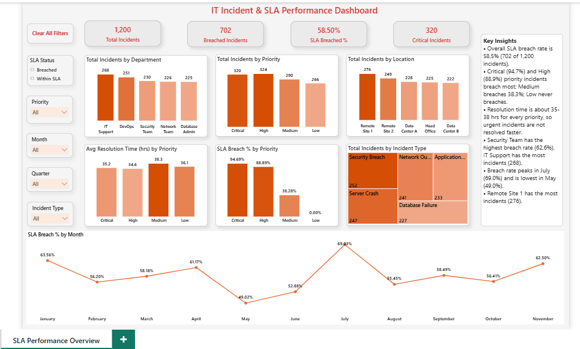
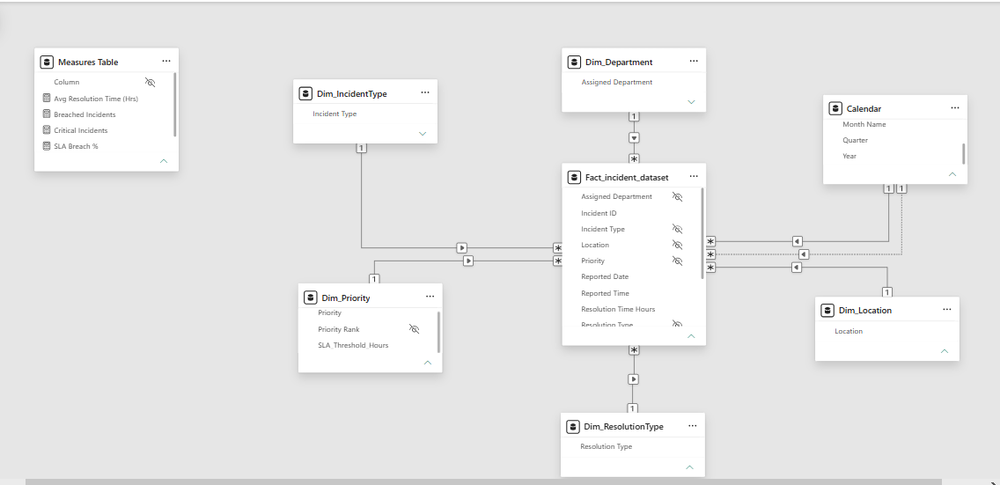

# IT Incident & SLA Performance Dashboard

A Power BI dashboard that analyzes 1,200 IT incidents to show where SLA targets are being missed. This is a self-initiated portfolio project that applies 5+ years of IT Service Management experience through a data analytics lens.



## Business Question
Which incidents breach their SLA and how do breaches vary by priority, department, location, incident type and month?

## Dataset
- Source: [Kaggle - it_incident_dataset]([ADD KAGGLE LINK](https://www.kaggle.com/datasets/laraibjutt/it-incident-dataset/data)), also included here as 'it_incident_dataset.csv'
- 1,200 incidents reported between January and November 2024 (972 Resolved, 228 Closed)
- **Data note:** average resolution time is almost identical for every priority (about 35-38 hours) and every incident resolves within 1-72 hours. A real operation would resolve Critical incidents much faster, so the dataset appears to be synthetic. The findings below demonstrate my analysis method, not conclusions about a real company.

## Tools
Power BI, Power Query, DAX

## SLA Definition
Each priority has a resolution target in `Dim_Priority`. An incident **breaches** its SLA when it is resolved **after** the target. An incident resolved exactly at the target counts as met (11 incidents fall exactly on their target).

| Priority | Target |
| --- | --- |
| Critical | 4 hrs |
| High | 8 hrs |
| Medium | 48 hrs |
| Low | 120 hrs |

## Data Model
Star schema: one fact table, five dimension tables and a calendar table.



| Fact column | Dimension / Calendar | Relationship |
| --- | --- | --- |
| Priority | Dim_Priority | many-to-one |
| Assigned Department | Dim_Department | many-to-one |
| Location | Dim_Location | many-to-one |
| Incident Type | Dim_IncidentType | many-to-one |
| Resolution Type | Dim_ResolutionType | many-to-one |
| Reported Date | Calendar[Date] | many-to-one (active) |
| Resolved Date | Calendar[Date] | many-to-one (inactive) |

The duplicate text columns in the fact table are hidden, so report visuals use the dimension columns.

## Data Preparation (Power Query)
1. Loaded the CSV from this repository and set data types.
2. Renamed columns to readable names (`Incident_ID` to `Incident ID`).
3. Added `Reported Date` and `Resolved Date` from the timestamp columns.
4. Built dimension tables by selecting one column and removing duplicates.
5. Built `Dim_Priority` with an SLA target and a sort order per priority:

```powerquery
#"Added SLA Threshold" = Table.AddColumn(#"Removed Duplicates", "SLA_Threshold_Hours",
    each if [Priority] = "Critical" then 4
    else if [Priority] = "High" then 8
    else if [Priority] = "Medium" then 48
    else if [Priority] = "Low" then 120
    else null, Int64.Type)
```
6. Built a calendar table covering 1 Jan to 30 Nov 2024, the range of the data.

## DAX
**SLA status** (calculated column in the fact table):
```DAX
SLA Status =
VAR Threshold = RELATED(Dim_Priority[SLA_Threshold_Hours])
RETURN IF(Fact_incident_dataset[Resolution Time Hours] > Threshold, "Breached", "Within SLA")
```

**Measures** (kept in a dedicated measures table). `COALESCE` returns 0 instead of blank when nothing matches, so categories with no breaches (like Low priority) still appear in charts and cards.
```DAX
Total Incidents = COUNTROWS(Fact_incident_dataset)

Breached Incidents =
COALESCE(
    CALCULATE([Total Incidents], Fact_incident_dataset[SLA Status] = "Breached"),
    0
)

SLA Breach % = DIVIDE(COALESCE([Breached Incidents], 0), [Total Incidents])

Critical Incidents =
COALESCE(
    CALCULATE([Total Incidents], Fact_incident_dataset[Priority] = "Critical"),
    0
)

Avg Resolution Time (Hrs) = AVERAGE(Fact_incident_dataset[Resolution Time Hours])
```

## KPIs
| Metric | Value |
| --- | --- |
| Total incidents | 1,200 |
| Breached incidents | 702 |
| SLA breach % | 58.50% |
| Critical incidents | 320 |

## SLA Performance by Priority
| Priority | Incidents | Target | Avg Resolution | Breach % |
| --- | --- | --- | --- | --- |
| Critical | 320 | 4 hrs | 35.2 hrs | 94.69% |
| High | 324 | 8 hrs | 34.6 hrs | 88.89% |
| Medium | 290 | 48 hrs | 38.3 hrs | 38.28% |
| Low | 266 | 120 hrs | 36.1 hrs | 0.00% |

Low never breaches only because its 120-hour target is above the 72-hour maximum in the data.

## Key Findings
- **58.5%** of incidents (702 of 1,200) breached their SLA.
- **Critical (94.7%) and High (88.9%)** incidents breach most. Medium breaches 38.3%.
- **Resolution time is almost the same for every priority** (about 35-38 hrs), so urgent incidents are not being resolved faster.
- **Security Team** has the highest breach rate (62.6%) and **Network Team** the lowest (54.9%). The spread across departments is only about 8 points, so it should not be over-read.
- **IT Support** has the most incidents (268) and the slowest average resolution (39.1 hrs).
- **Breach rate peaks in July (69.0%)** and is lowest in May (49.0%).
- **Remote Site 1** has the most incidents (276).
- Security Breach (252) and Server Crash (247) are the most common incident types.

## Dashboard Features
- KPI cards for total, breached and critical incidents and breach %
- Breakdowns by department, priority, location and incident type
- Monthly SLA breach trend
- Slicers for SLA status, priority, month, quarter and incident type, plus a Clear All Filters button
- The SLA Status slicer filters the breakdown charts, while the KPI cards and the breach % charts stay at the overall values

## Recommendations
If these patterns held in real data, I would:
- Create a fast-track queue for Critical and High incidents and review why they are resolved no faster than Low ones.
- Alert team leads when a Critical incident passes 2 hours without an update.
- Review the Medium SLA target, since 38% of Medium incidents breach.
- Investigate July, the peak month, for staffing or change-related causes.
- Check workload and resolution time in IT Support, which has the highest volume and the slowest average.

## Limitations
- The data appears synthetic, so no real-world conclusion can be drawn.
- The dataset covers January to November 2024 only, so Q4 is incomplete and seasonality can't be confirmed.
- Months are counted by the date an incident was reported; 54 incidents were resolved in a later month.
- Counting incidents exactly at their target as breached would raise breaches from 702 to 713.
- There is no staffing, shift or change-calendar data, so causes of breaches are hypotheses.

## How to Open
Download `it_incident_sla_dashboard.pbix` and open it in Power BI Desktop. To refresh the data, the dataset file must stay in this repository.

## What I Learned
- Building a star schema with a dedicated measures table and a calendar.
- Working with SLA logic in DAX, handling blanks versus zeros and checking my results by recalculating them independently from the raw data.
- Telling the difference between what happened and why it might have happened.

---
Built with Power BI | Power Query | DAX
